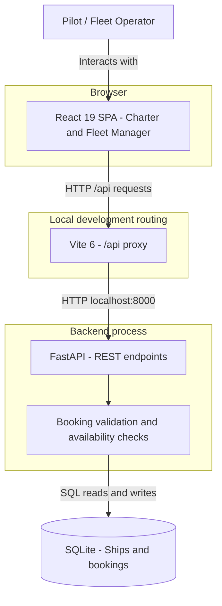
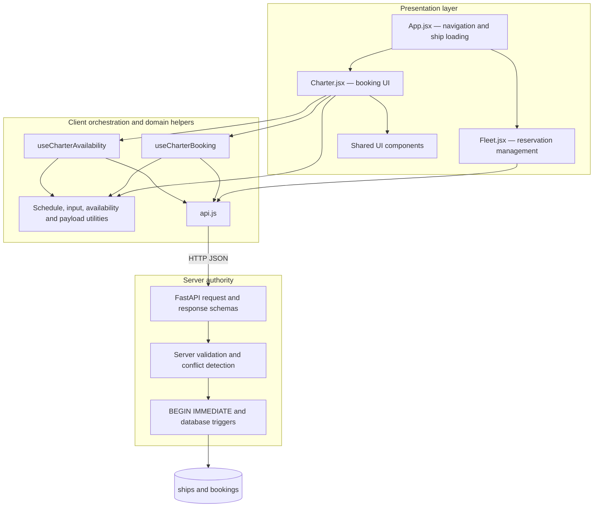
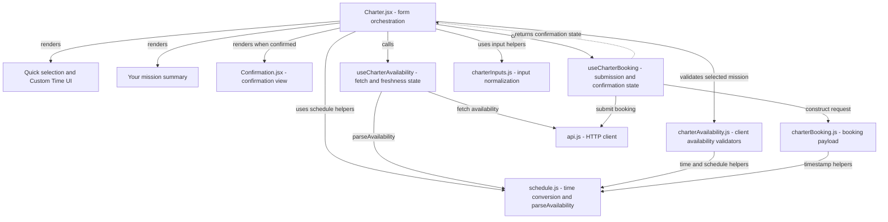
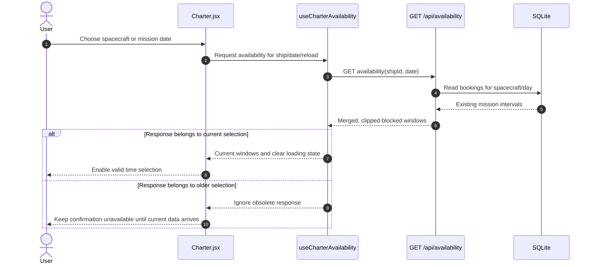
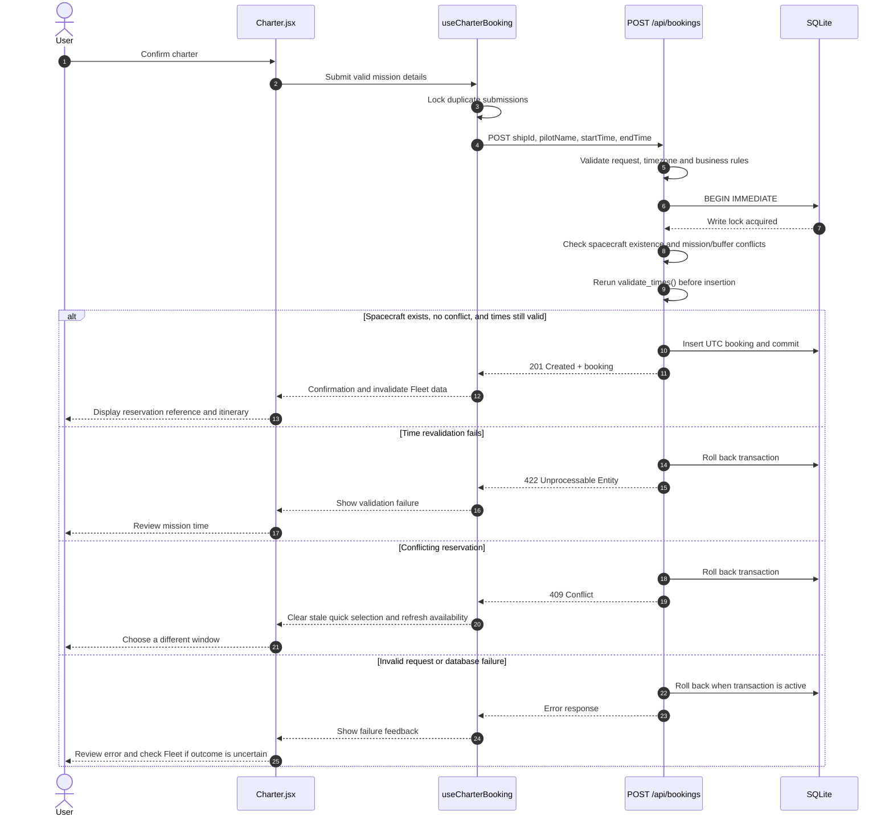
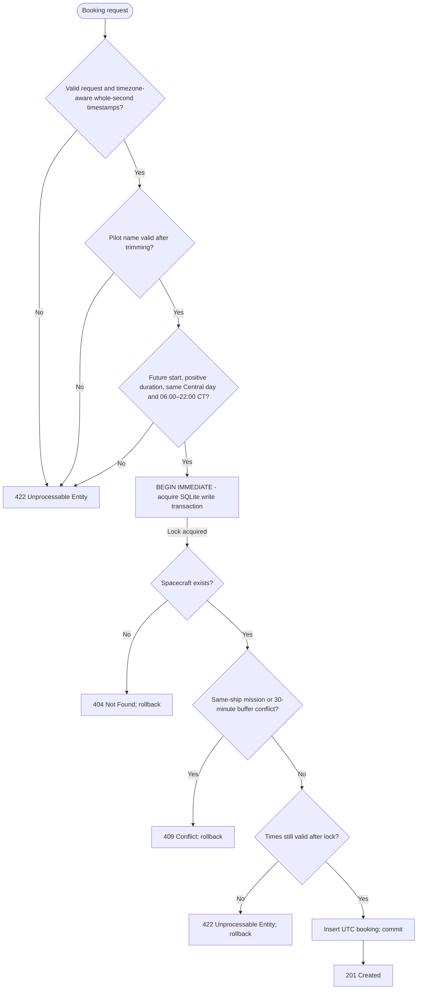
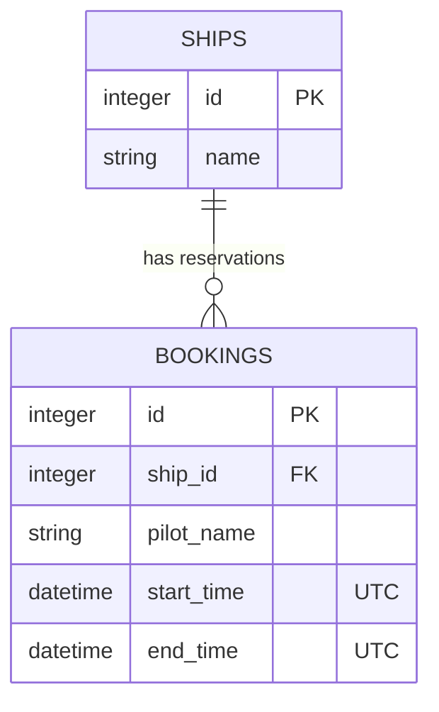
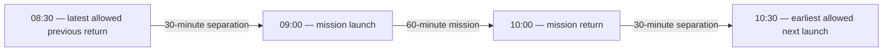

# Pacific Spaceport Charter System

A spacecraft reservation and operations application built with **React 19, Vite 6, FastAPI, and SQLite**. Users book through Quick Selection or exact Custom Time and review reservations in Fleet Manager.

All displayed mission dates and times use **America/Chicago (Central Time)**, including daylight saving time. The backend is the final authority for validation and conflict prevention.

## Architecture at a glance

> **System classification:** Single-page application (SPA) with a REST API and a transactional relational database.  
> **Primary use case:** Reserve a spacecraft for a valid Central Time mission window without double-booking or violating refueling separation.  
> **Design principle:** The frontend offers responsive guidance; **FastAPI and SQLite enforce booking correctness**.  
> **Deployment posture:** Verified local-development application; production security and operations controls are not yet implemented.

| Dimension | Current design |
| --- | --- |
| Presentation | React 19 SPA, Vite 6, responsive booking and fleet views |
| API | FastAPI REST endpoints under `/api` |
| Persistence | SQLite with guarded transactions and database triggers |
| Time model | America/Chicago for scheduling and display; UTC for stored timestamps |
| Booking modes | Half-hour Quick Selection and arbitrary-minute Custom Time |
| Conflict policy | No overlapping missions on the same spacecraft; minimum 30-minute separation |
| Verification baseline | 77 frontend tests, 33 backend tests, successful production build and fresh-database seed import (reported November 4, 2026) |

## Documentation map

**Start here (new contributors):** [Beginner setup](#beginner-setup) → [Using the application](#using-the-application) → [Tests](#tests-and-edge-cases-covered).  
**Architecture path (developers):** [High-level design](#high-level-design) → [Low-level design](#low-level-design) → [Booking rules](#booking-rules-and-availability) → [API reference](#api-reference).  
**Operations and safety:** [Database safety](#database-safety) → [Troubleshooting](#troubleshooting) → [Production limitations](#production-build-and-limitations).

<details>
<summary><strong>Full table of contents</strong></summary>

- [Architecture at a glance](#architecture-at-a-glance)
- [Features and completed work](#features-and-completed-work)
- [Beginner setup](#beginner-setup)
- [Using the application](#using-the-application)
- [High-level design](#high-level-design)
- [Low-level design](#low-level-design)
- [Project structure](#project-structure)
- [Booking rules and availability](#booking-rules-and-availability)
- [API reference](#api-reference)
- [Tests and edge cases covered](#tests-and-edge-cases-covered)
- [Database safety](#database-safety)
- [Troubleshooting](#troubleshooting)
- [Production build and limitations](#production-build-and-limitations)

</details>

---

## Features and completed work

### Charter a Ship

- Five spacecraft: USS Wanderer, Nostromo, Serenity, Rocinante, and Millennium Falcon.
- Quick Selection: 32 half-hour launch starts, grouped into Morning, Afternoon, and Evening, with preset mission durations.
- Custom Time: exact arbitrary-minute scheduling. **14:07–14:44 CT is a 37-minute mission**, with no half-hour rounding.
- Controlled 24-hour entry: four-digit input such as `1407` becomes `14:07`; completed single-digit hours can be normalized without losing minute precision.
- Pilot-name validation and capitalization.
- Distinct availability loading, failure/Retry, clear-schedule, and zero-free-start states.
- A launch-start count and information control explaining why gray starts can be unavailable.
- A concise **Your mission** summary with a valid itinerary or neutral placeholder; detailed custom-time errors appear beside the inputs.
- Confirmation with reference, spacecraft, pilot, exact Central Time window, date, and duration.
- Duplicate-click protection, pending feedback, HTTP 409 recovery, and availability refresh.

### Fleet Manager

- Search by pilot, spacecraft, or reservation reference; filter by spacecraft, status, and dates; sort by mission date.
- Readable reservation rows with exact time ranges, separate dates, references, and long-name handling.
- Five reservations per card initially, with **Show all / Show fewer** controls and singular/plural counts reflecting active filters.
- Daily timeline with teal missions and amber pre/post-mission refueling windows. Its selected-day scope is independent of booking-card filters.
- Fleet statistics, including an explained 30-day fleet utilization metric.
- Loading placeholders instead of misleading initial zeros; refresh failures preserve the last loaded results.

### Shared UX and reliability

- Shared spacecraft SVG for the header mark and favicon; teal navigation and a sticky responsive header.
- Mint available starts, orange selected starts/action, gray unavailable starts, amber buffers, green success, and red errors.
- Accessible dark-orange confirmation styling, consistent select spacing, focus indicators, and responsive typography.
- Heading focus and scroll coordination on page navigation, accounting for sticky-header height.
- Initial spacecraft-loading Retry without a full page reload.
- Availability keyed by spacecraft/date/reload, preventing stale responses from enabling confirmation for the wrong selection.
- Current-time refresh while the page is open and when the window regains focus.
- Dedicated hooks and pure scheduling/input helpers, backed by frontend and backend regression tests.

## Beginner setup

### 1. Install the prerequisites

Use these runtimes for the current repository:

- **Python 3.12**: used for local verification. SQLite is included with Python; no separate database server is needed.
- **Node.js 24.x**, including npm. The installed Vite/Vitest/jsdom toolchain also supports Node **22.13+ within the 22.x line**. An older Node version may run Vite but fail to run the tests.
- A terminal and web browser. Git is only needed if you obtain the project by cloning it.

Check your installations:

```bash
python3 --version
node --version
npm --version
```

On Windows, try `py --version` instead of `python3`. If a command is not found, install the runtime, reopen your terminal, and check again.

### 2. Open the project

Download/extract or clone the project. Open a terminal **inside the folder containing this README, `backend/`, and `frontend/`**.

You need **two terminal windows**: one for the backend and one for the frontend. Both servers must remain running while you use the app.

### 3. Start the backend — Terminal 1

#### macOS / Linux / WSL

Starting from the project root:

```bash
cd backend
python3 -m venv .venv
source .venv/bin/activate
python -m pip install -r requirements.txt

# Use a separate development database, preserving the supplied spaceport.db.
export SPACEPORT_DB="$PWD/spaceport.local.db"
python import_seed.py seed.json

python -m uvicorn main:app --reload --host 127.0.0.1 --port 8000
```

#### Windows PowerShell

Starting from the project root:

```powershell
cd backend
py -3 -m venv .venv
.\.venv\Scripts\Activate.ps1
python -m pip install -r requirements.txt

# Windows may need this package for the America/Chicago timezone database.
python -m pip install tzdata

$env:SPACEPORT_DB = Join-Path (Get-Location).Path "spaceport.local.db"
python import_seed.py seed.json

python -m uvicorn main:app --reload --host 127.0.0.1 --port 8000
```

If PowerShell blocks environment activation, use `.\.venv\Scripts\python.exe` instead of `python` for the pip, import, and uvicorn commands. This avoids changing execution policy.

What these commands do:

1. `.venv` creates an isolated Python environment for dependencies.
2. `requirements.txt` installs FastAPI, Uvicorn, and backend test dependencies.
3. `SPACEPORT_DB` selects a separate local database. Keep this variable set in the backend terminal.
4. `import_seed.py` loads the **included** spacecraft and sample bookings. No `seed.py` generator is required: `backend/seed.json` already exists.
5. Uvicorn starts the API. Leave this terminal open.

Check [API documentation](http://127.0.0.1:8000/docs) or [spacecraft JSON](http://127.0.0.1:8000/api/ships). The spacecraft endpoint should return five ships.

> The importer writes data. It skips identical bookings, upserts spacecraft names, and rolls back conflicting imports. For first-time setup, use the new local database above rather than importing into valuable existing data.

### 4. Start the frontend — Terminal 2

Open a **new terminal in the project root**:

```bash
cd frontend
npm ci
npm run dev
```

`npm ci` installs dependencies from `package-lock.json`. Open [Pacific Spaceport](http://localhost:5173) in your browser. Vite forwards `/api` requests to the backend at `http://127.0.0.1:8000`.

### 5. Stop and restart later

- Press **Ctrl+C** in each server terminal to stop it. Closing the browser does not stop the servers.
- On subsequent runs, activate the backend environment, set `SPACEPORT_DB` to the **same absolute database path**, and start Uvicorn. Reimporting the seed is not necessary each time.
- Run `npm run dev` from `frontend/`. Reinstall dependencies when needed, such as after a lockfile change.
- No API keys or `.env` file are required. The backend reads `SPACEPORT_DB` from the process environment; it does not automatically load `.env` files.

## Using the application

1. Open **Charter a Ship** and choose spacecraft, mission date, and pilot.
2. For **Quick Selection**, choose a duration and available start. Gray starts can be past, blocked, or too late to fit the duration before closing.
3. For **Custom Time**, enter launch and return in `HH:mm`, such as `14:07` and `14:44`. The quick-mode duration does not determine custom duration.
4. Review **Your mission**. Confirmation requires a valid pilot, valid future window, and current successful availability data.
5. Confirm once. The server checks again; availability may have changed since it was displayed.
6. Review the confirmation/reference, book another mission, or open Fleet Manager.

Choose a genuinely future date when exploring. Historical seed bookings remain visible under **All bookings** or **Past** filters, but new past bookings are rejected.

## High-level design

The HLD describes the **system boundaries, runtime responsibilities, and principal data paths**. The development proxy is shown explicitly because it is not present in a production static build.

### HLD-01 — Application runtime architecture (local development)



**Diagram scope:** This diagram represents the application's local-development runtime architecture. The React SPA communicates with FastAPI through Vite's development proxy. FastAPI owns business validation, availability calculation, and booking transactions; SQLite stores spacecraft and reservations. The diagram is intentionally simplified to show the major runtime components rather than internal implementation details.

**Production boundary:** The static React build must be hosted separately and `/api` must be routed to FastAPI by production infrastructure. The Vite proxy is a development convenience, not a production component.

### HLD-02 — Logical architecture and ownership



| Architectural concern | Owning component | Contract / guarantee |
| --- | --- | --- |
| Navigation and initial spacecraft retrieval | `App.jsx` | Loads spacecraft and coordinates view transitions, retry, focus and scroll |
| Mission entry and selection | `Charter.jsx` | Collects spacecraft/date/pilot and supports Quick or Custom Time |
| Availability freshness | `useCharterAvailability` | Keys responses by spacecraft/date/reload; stale data cannot authorize submission |
| Submission lifecycle | `useCharterBooking` | Prevents duplicate clicks, handles confirmation, errors and HTTP 409 recovery |
| Local scheduling calculations | `utils/` | Pure Central Time, interval, input and payload operations |
| Fleet reporting | `Fleet.jsx` | Client-side search/filter/sort, metrics and daily timeline |
| API transport | `api.js` | Same-origin `/api`, JSON handling and HTTP errors |
| Booking authority | `backend/main.py` | Validates requests and serializes conflicting writes |
| Durable integrity | SQLite | UTC persistence, foreign keys, triggers and transactional consistency |

### HLD-03 — Primary business workflow

This workflow illustrates the primary user-facing booking and fleet-management journey, including spacecraft selection, Quick Selection and Custom Time, availability checks, booking confirmation, and error recovery. It is a behavioral view of the application, not an additional deployment or component-architecture diagram.


### Architectural decisions and constraints

| Decision | Rationale | Trade-off / boundary |
| --- | --- | --- |
| Server-authoritative validation | Prevents bypassing browser checks and accepting stale availability | UI availability is advisory until submission succeeds |
| SQLite `BEGIN IMMEDIATE` for booking writes | Serializes write-side conflict checks and inserts | SQLite supports limited write concurrency; not a distributed scheduler |
| UTC persistence and Central Time presentation | Stable instants across DST and client timezones | Requires explicit conversion and DST-aware validation |
| Derived 30-minute buffers | Keeps one booking record as the source of truth | Availability merges intervals and does not expose per-segment reasons |
| Client-side Fleet filtering | Keeps the current implementation simple | No server pagination or large-scale query strategy |

## Low-level design

The LLD explains **which module handles each operation**, the request/response sequence, the data model and the conditions under which a booking is accepted. Diagrams describe the documented implementation rather than proposed infrastructure.

### LLD-01 — Frontend module interactions



**Ownership:** `useCharterAvailability` obtains and parses availability through `schedule.js`; `Charter.jsx` calls the client-side availability validators; `useCharterBooking` owns submission/confirmation state, while `Charter.jsx` decides when to render `Confirmation.jsx`. Arrows represent module usage or state flow, not direct component rendering by hooks.

### LLD-02 — Availability read and stale-response protection



**Important distinction:** An unavailable *start time* is calculated from the entire proposed mission, operating hours, the current instant and buffered blocked intervals. It is not equivalent to a reservation occupying that exact start instant.

### LLD-03 — Booking write transaction and failure handling



**Concurrency guarantee:** Two conflicting requests for the same spacecraft cannot both commit under the documented transaction and conflict checks. The browser's duplicate-click lock is additional UX protection, **not** a server-side idempotency protocol.

### LLD-04 — Reservation decision logic



The diagram shows the principal success and validation/conflict branches. **Pilot and time validation occur before the write transaction and spacecraft lookup**: an invalid time combined with an unknown spacecraft therefore produces **422**, not **404**. After acquiring the write lock, the implementation checks spacecraft existence and booking conflicts, then reruns `validate_times()` immediately before insertion. Database write contention may return **503**; see the [API reference](#api-reference) for the documented status codes.

### LLD-05 — Logical data model



**Persistence invariants:** `bookings.ship_id` references `ships.id`; bookings store UTC-normalized start and end timestamps; database guards protect direct writes. Refueling periods are **computed**, not persisted in a separate table.

### LLD-06 — Time and buffer example



For the **same spacecraft**, a mission ending at **10:00 CT** allows the next mission to begin at **10:30 CT**, not 10:29. The buffer is a single minimum gap between consecutive missions; the diagram does not imply an extra 30 minutes must be added twice. Different spacecraft can be booked at identical times.

### LLD-07 — Interface and data contracts

| Operation | Inputs | Output / behavior | Failure handling |
| --- | --- | --- | --- |
| Load spacecraft | `GET /api/ships` | Spacecraft list for booking and Fleet | Initial-load Retry |
| Read availability | `shipId`, Central `date` | Buffered, merged blocked intervals | Loading/error state; stale responses ignored |
| Read Fleet | `GET /api/bookings` | Booking records; filters and sorting applied in browser | Preserve last loaded results on refresh failure |
| Create booking | `shipId`, `pilotName`, timezone-aware start/end | HTTP 201 with booking details | 409 refresh; 422 invalid; 503 contention; uncertain network outcome requires Fleet check |

For exact field names, examples and status codes, see the [API reference](#api-reference). For edge conditions, see [Booking rules and availability](#booking-rules-and-availability).

---

## Project structure

```text
spaceport-charter/
├── README.md
├── backend/
│   ├── main.py                    # FastAPI, validation, schema/triggers, transactions
│   ├── import_seed.py             # Transactional sample-data importer
│   ├── seed.json                  # Included spacecraft and sample bookings
│   ├── requirements.txt
│   ├── spaceport.db               # Default project database; preserve existing data
│   └── .venv/                     # Generated Python environment
├── frontend/
│   ├── index.html                 # Document title and favicon reference
│   ├── package.json
│   ├── package-lock.json
│   ├── vite.config.js             # Port 5173 and /api proxy to port 8000
│   ├── .prettierrc.json
│   ├── public/
│   │   └── spaceport-icon.svg     # Shared header mark and favicon
│   ├── src/
│   │   ├── main.jsx               # React entry point and CSS import
│   │   ├── api.js
│   │   ├── css/
│   │   │   ├── index.css          # Imports the stylesheet modules
│   │   │   ├── base.css           # Tokens, typography, shared controls/header
│   │   │   ├── charter.css
│   │   │   ├── custom-and-feedback.css
│   │   │   ├── confirmation.css
│   │   │   ├── fleet.css
│   │   │   └── responsive.css
│   │   └── js/
│   │       ├── App.jsx
│   │       ├── pages/
│   │       │   ├── Charter.jsx
│   │       │   ├── Fleet.jsx
│   │       │   ├── Charter.test.jsx
│   │       │   └── CharterSubmission.test.jsx
│   │       ├── components/
│   │       │   ├── Header.jsx
│   │       │   ├── SectionHeading.jsx
│   │       │   ├── TimeRange.jsx
│   │       │   └── Confirmation.jsx
│   │       ├── hooks/
│   │       │   ├── useCharterAvailability.js
│   │       │   ├── useCharterBooking.js
│   │       │   └── *.test.jsx
│   │       └── utils/
│   │           ├── schedule.js
│   │           ├── charterInputs.js
│   │           ├── charterAvailability.js
│   │           ├── charterBooking.js
│   │           └── *.test.js
│   ├── node_modules/              # Generated dependencies
│   └── dist/                      # Generated production build
└── tests/
    └── test_api.py                # Backend/API/SQLite regression tests
```

Additional local database copies/backups may exist under `backend/`. These are data artifacts, not source; do not delete or overwrite them as a setup/cleanup step.

## Booking rules and availability

- **Hours:** 06:00–22:00 CT on one Central calendar date. Starting exactly at opening or finishing exactly at closing is allowed.
- **Future launch:** strictly later than the current instant. The browser's local wall clock does not define the mission timezone.
- **Positive duration:** return must follow launch. Overnight missions are rejected.
- **Refueling:** successive missions on the **same spacecraft** need at least 30 minutes between them. This is one 30-minute gap, not two consecutive 30-minute gaps.
- **Example:** after a 09:00–10:00 mission, 10:29 conflicts; 10:30 is allowed if otherwise valid. A preceding mission must finish by 08:30.
- **Independent spacecraft:** identical mission times on different ships are allowed.
- **Precision:** Custom Time preserves arbitrary minutes. The API accepts timezone-aware whole-second timestamps and rejects fractional seconds; it does not impose half-hour starts or frontend preset durations.
- **Pilot:** frontend accepts 2–100 characters using letters, combining marks, spaces, apostrophes, and hyphens, and capitalizes names. Backend independently requires a nonblank trimmed name up to 120 characters; its contract is less restrictive.

### Blocked intervals versus unavailable launch starts

The availability endpoint expands reservations by 30 minutes before/after, merges overlapping/touching windows, and clips them to operating hours. Merged windows do not expose individual reservation-versus-buffer segments.

The frontend checks the **whole proposed mission** against those windows. With a blocked interval of 09:00–11:00 and a 60-minute mission, an 08:30 start is unavailable even though 08:30 itself is outside the blocked interval. A mission ending exactly at 09:00 or starting exactly at 11:00 can be allowed.

A gray start therefore does not prove occupancy at that exact instant. Past time and insufficient remaining operating hours also make starts unavailable. Loading/failure states must not be interpreted as zero free capacity.

### Fleet utilization

The existing metric is fleet-wide and independent of booking-card filters:

```text
30-day fleet utilization =
  mission minutes intersecting the reporting window
  ------------------------------------------------ × 100
  spacecraft count × 30 days × 16 hours × 60 minutes
```

The window begins at 06:00 CT 29 calendar days before today and ends at 22:00 CT today. Mission durations are clipped to that window; refueling buffers are excluded. The display is capped at 100% and rounded to one decimal place. Five spacecraft provide a denominator of **144,000 operating minutes**.

## API reference

Browser requests use relative `/api` URLs. The development proxy forwards them to FastAPI.

| Method | Endpoint | Purpose |
| --- | --- | --- |
| GET | `/api/ships` | List spacecraft. |
| GET | `/api/availability?shipId=1&date=YYYY-MM-DD` | Buffered/merged blocked windows for one spacecraft and Central date. |
| GET | `/api/bookings` | All bookings; Fleet filters/sorts them locally. |
| POST | `/api/bookings` | Create a reservation. |

Example request body for a **future, free** date:

```json
{
  "shipId": 1,
  "pilotName": "Alex Nova",
  "startTime": "2030-01-15T14:07:00-06:00",
  "endTime": "2030-01-15T14:44:00-06:00"
}
```

This example uses a January Central offset. Do not reuse `-06:00` blindly for summer dates; the frontend handles America/Chicago conversion.

| Status | Meaning |
| --- | --- |
| 201 | Created; response includes reference, spacecraft ID, pilot, and timestamps. |
| 404 | Unknown spacecraft. |
| 409 | Booking overlap or insufficient refueling gap. |
| 422 | Invalid request, timezone/precision, pilot, duration, hours, or past launch. |
| 503 | Database temporarily busy due to write contention. |

Use [Swagger UI](http://127.0.0.1:8000/docs) to inspect schemas. Read-only checks: [ships](http://127.0.0.1:8000/api/ships) and [bookings](http://127.0.0.1:8000/api/bookings). Sending a POST through Swagger creates data in the selected database.

## Tests and edge cases covered

### Run the checks

Frontend, from `frontend/`:

```bash
npm test
npm run build
```

For watch mode, run `npm run test:watch`.

Backend, from the **project root**:

```bash
# macOS / Linux / WSL: explicit environment path; activation is not required.
backend/.venv/bin/python -m pytest -q tests
```

With the environment activated, `python -m pytest -q tests` also works from the root.

**Test database warning:** `tests/test_api.py` creates a unique temporary directory and SQLite database for each test process using Python's `tempfile.TemporaryDirectory()`. The test fixtures reset data within that isolated database. The suite does not intentionally modify the development database selected by SPACEPORT_DB in another process. Do not point external applications at the test database. Temporary test data is cleaned up when the test process exits

Latest local verification, **November 4, 2026**:

| Check | Result |
| --- | --- |
| Frontend Vitest suite | **77 tests passed across 9 files** |
| Backend pytest suite | **33 tests passed** |
| Vite production build | **Passed** |
| Seed import into a fresh temporary database | **5 spacecraft and 3,000 sample bookings imported** |

An existing Starlette TestClient/httpx deprecation warning appears in backend tests. Counts describe this checkout, not a permanent guarantee. Some API tests use 2027/2028 future dates; those fixtures will eventually need advancing as real time passes.

The seed-import smoke test used the existing Python environment and a new temporary SQLite database. A fresh dependency installation and the native Windows setup commands were not executed during this documentation update.

### Automated coverage

| Area | Edge cases covered |
| --- | --- |
| Time entry | Four-digit normalization, single-digit hours, partial edits, incomplete input, arbitrary minutes, invalid hours/minutes, alphabetic input, extra characters/colons. |
| Pilot input | Capitalization, accepted names, and whitespace-only rejection. |
| Custom validation | Past/future launches, incomplete neutral states, reversed ranges, operating hours, exact closing, overlaps, allowed boundaries, and stale/loading/error rejection. |
| Central Time/DST | CST/CDT offsets, transition dates, local-time round trips, exact-minute preservation, and elapsed-duration preservation. |
| Quick selection | 32 half-hour starts, past launches, duration beyond closing, exact closing, blocked overlap/boundaries, and stale/loading/error availability. |
| Availability hooks | Load/parse results, ignore obsolete spacecraft responses, fail closed on errors, and require fresh results after reload. |
| UI availability races | Changing spacecraft disables confirmation immediately; late responses cannot restore availability belonging to the old selection. |
| Payload construction | Numeric ship ID, normalized pilot, quick duration, exact custom timestamps, independence from quick-mode duration. |
| Submission | Confirmation, disabled submission, duplicate-click protection, HTTP 409 refresh/recovery, ordinary API failures, and reset. |
| API validation | Blank pilots, unknown ships, missing timezone, wrong supplied offset, fractional seconds, invalid duration, past starts, and operating boundaries. |
| Refueling | Exact 30-minute gaps accepted; 29-minute gaps, touching missions, and overlaps rejected; specific pre/post-buffer conflict messages. |
| Availability endpoint | Empty/unknown-ship days, merged adjacent windows, opening/closing clipping, and independent spacecraft schedules. |
| Persistence/concurrency | SQLite triggers reject invalid direct inserts; simultaneous conflicting requests produce one success and one HTTP 409. |
| API shape | Booking/pilot/ship fields and documented creation/error responses in OpenAPI. |

### Manual browser QA history

UI refinement sessions exercised **1440×1000**, **768×1024**, and **390×844** layouts: long names, exact-minute ranges, empty/one/five/sixteen-reservation cards, expansion controls, neutral/invalid/valid custom windows, disabled actions, heading/focus behavior, and document overflow. Controlled clocks covered past/future today, future dates, hours, booking/buffer overlaps, and DST-day operating windows. Temporary database copies were used for submission testing.

These are **manual verification records**, not an automated end-to-end suite or a claim that every subsequent UI change was visually retested. Native macOS Chrome popup appearance and actual VoiceOver/NVDA speech were not fully verified. Recheck the current UI before release; DOM tests alone cannot establish visual quality or screen-reader behavior.

Suggested manual regression journey:

1. Select a future date and clear spacecraft; check counts and quick/custom modes.
2. Enter `14:07–14:44` and verify 37 minutes. Reverse the range: only one detailed error should appear and confirmation must stay disabled.
3. Change spacecraft/date while availability is pending; wait for the new result before allowing confirmation.
4. Exercise loading, empty, failure/Retry, and zero-free-start states separately.
5. Use a disposable database for successful submissions, concurrent conflicts, and recovery. Never use original data for destructive QA.
6. Check Fleet filter scope, sorting, five-row expansion, zero/one counts, and exact times.
7. Check Tab navigation, focus visibility, sticky-header offsets, mobile overflow, and screen-reader announcements.

## Database safety

- Default database: `backend/spaceport.db`, unless `SPACEPORT_DB` overrides it. The setup above uses `backend/spaceport.local.db` to preserve supplied data.
- Use an **absolute path** for overrides; relative paths resolve against the process's working directory.
- Importing `backend/main.py` initializes missing tables/indexes/triggers. Starting the backend is not a read-only inspection operation.
- A new database gets its schema automatically, but not its spacecraft. Import the seed into the intended new database before use.
- Back up before imports, migrations, or manual QA. Stop writers before a plain database-file copy, or use SQLite's backup facilities.
- Keep temporary test data, database backups, `.venv`, `node_modules`, and generated builds out of shared source changes as appropriate to repository policy.

## Troubleshooting

| Symptom | What to check |
| --- | --- |
| Runtime command not found | Install Python/Node and reopen the terminal. |
| Missing FastAPI/Uvicorn/pytest | Use the backend environment's Python and install its requirements. |
| `ZoneInfoNotFoundError: America/Chicago` | Install `tzdata` in the same environment, especially on Windows. |
| SQLite lacks `unixepoch` | Use Python linked to SQLite 3.38+; inspect with `python -c "import sqlite3; print(sqlite3.sqlite_version)"`. |
| Port 8000/5173 occupied | Stop the earlier server with Ctrl+C in its terminal. Keep defaults unless updating the proxy too. |
| Cannot load ships/availability | Verify Uvicorn and `/api/ships`; use Retry and confirm both processes use the intended checkout. |
| Expected JSON but got HTML/text | Check backend startup errors and the Vite `/api` proxy; the response may be an error page. |
| Empty ships / unknown spacecraft | Check `SPACEPORT_DB` and seed the intended new database. |
| All starts gray | Check Central date/current time, duration, closing time, and blocked windows. Earlier times today are correctly unavailable. |
| Launch is in the past | Compare the selected Central date/time with America/Chicago now, then choose a future window. |
| HTTP 409 | Review refreshed availability and select another mission window. |
| Network error after Confirm | Check Fleet before resubmitting; the server may have committed despite a lost response. |
| Vitest/jsdom engine error | Check Node's version; updating npm alone does not update Node. |
| Dated tests stop passing | Advance future-date fixtures as appropriate; do not disable past-booking validation. |

## Production build and limitations

```bash
cd frontend
npm ci
npm run build
```

The static frontend is generated in `frontend/dist/`. Building does not start FastAPI or configure a production reverse proxy.

- Serve the built frontend and route `/api` to FastAPI. Vite's development proxy is not part of the static build.
- Current asset/API URLs assume site-root hosting; subpath hosting requires configuration.
- Provide a writable persistent database path, backups, and appropriate filesystem permissions.
- The two-terminal workflow and `--reload` are for development. Production supervision, TLS, authentication, authorization, monitoring, and deployment configuration require separate work.
- No pilot accounts, cancellation/editing endpoints, or payment workflow are implemented.
- Fleet fetches all bookings and filters locally; server pagination and larger-scale data architecture are not implemented.
- SQLite serializes writers. Transactions protect conflicts, but this is not a distributed reservation system.
- Availability can change before confirmation. Frontend duplicate-click protection is not a server idempotency-key protocol.
- The availability API returns merged intervals, not segment-level reservation/refueling reasons.
- Interactive timeline mission-detail panels remain deferred.
- Full browser and assistive-technology verification is required before claiming production accessibility compliance.
