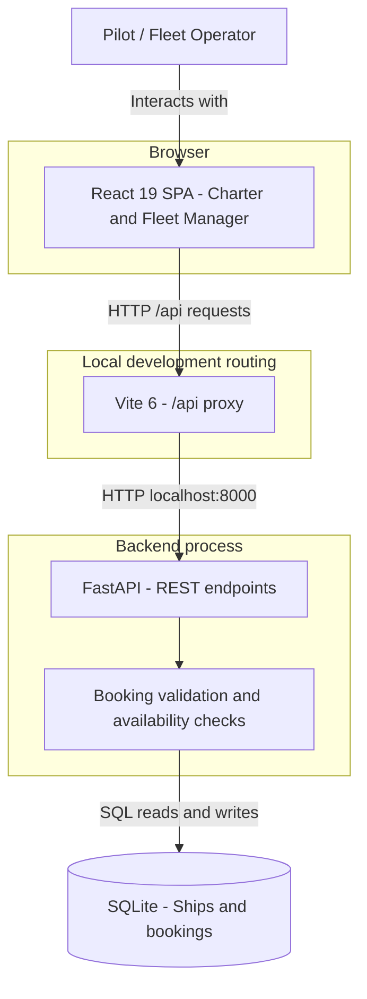
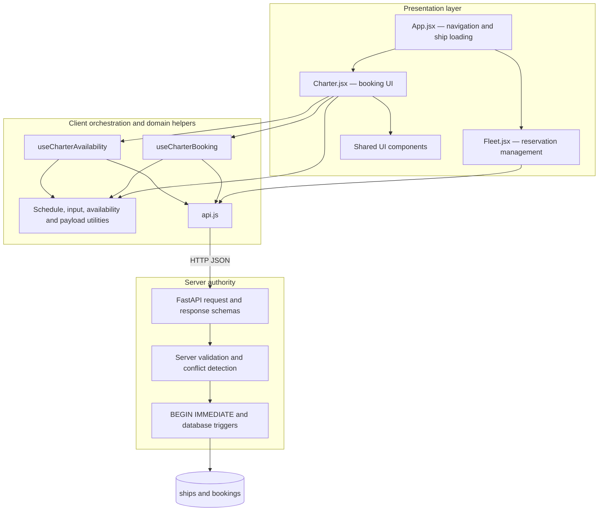
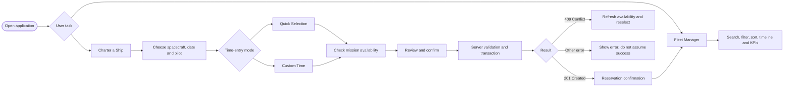
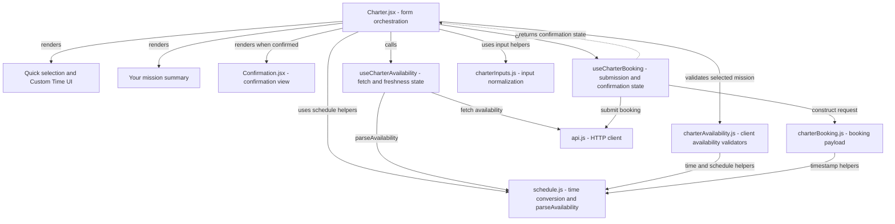
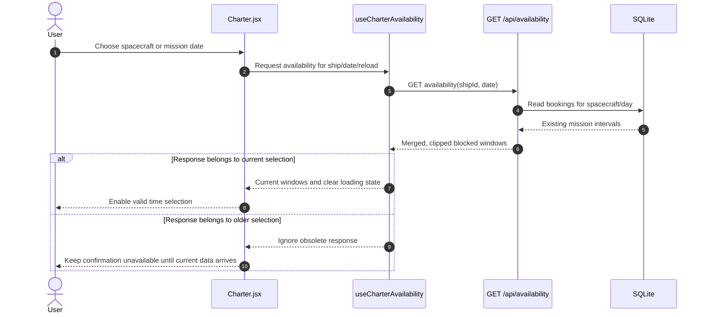
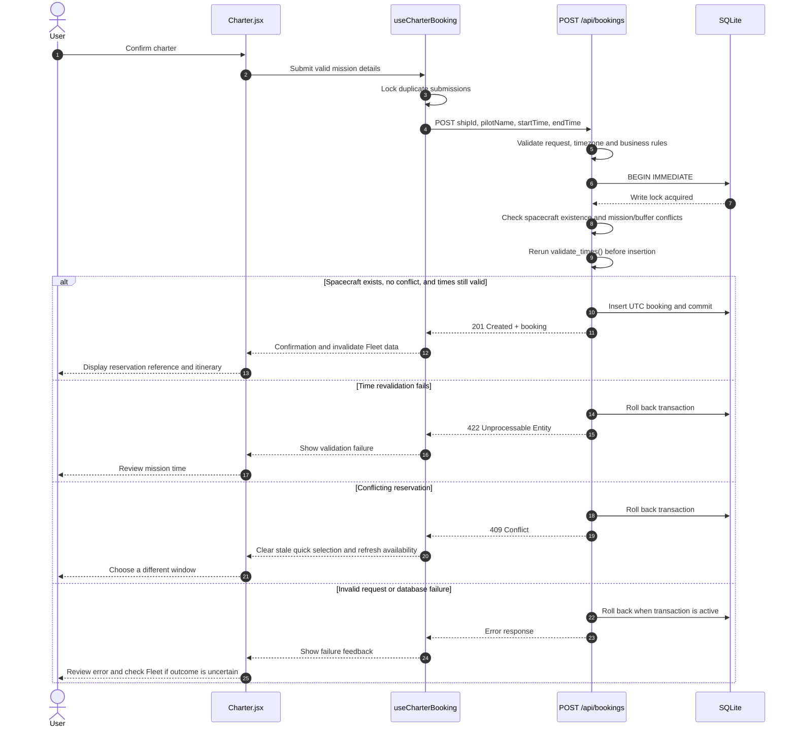
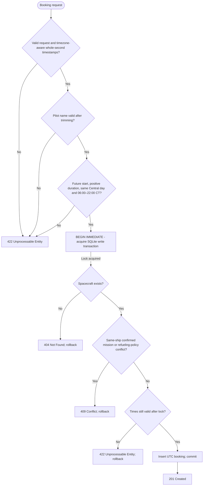
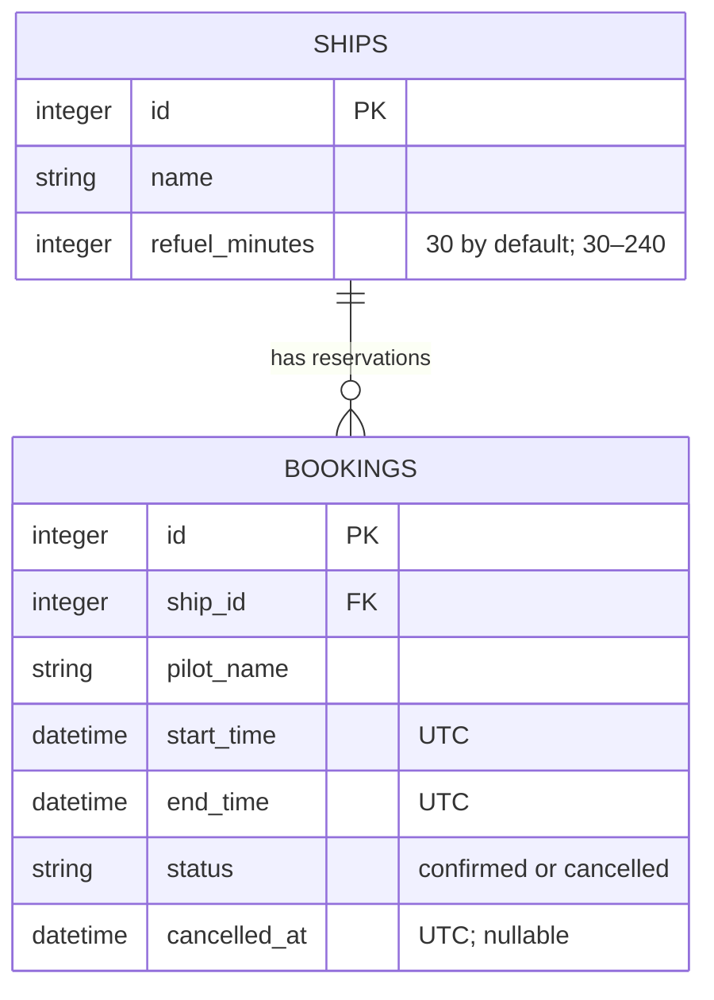

# Pacific Spaceport Charter System

A spacecraft reservation and operations application built with **React 19, Vite 6, FastAPI, and SQLite**. Users book through Quick Selection or exact Custom Time and review reservations in Fleet Manager.

All displayed mission dates and times use **America/Chicago (Central Time)**, including daylight saving time. The backend is the final authority for validation and conflict prevention.

## Architecture at a glance

> **System classification:** Single-page application (SPA) with a REST API and a transactional relational database.  
> **Primary use case:** Reserve a spacecraft for a valid Central Time mission window without double-booking or violating refueling separation.  
> **Design principle:** The frontend offers responsive guidance; **FastAPI and SQLite enforce booking correctness**.  
> **Deployment posture:** Verified local-development application; production security and operations controls are not yet implemented.

| Dimension | Current design |
| --- | --- |
| Presentation | React 19 SPA, Vite 6, responsive booking and fleet views |
| API | FastAPI REST endpoints under `/api` |
| Persistence | SQLite with guarded transactions and database triggers |
| Time model | America/Chicago for scheduling and display; UTC for stored timestamps |
| Booking modes | Half-hour Quick Selection and arbitrary-minute Custom Time |
| Conflict policy | No overlapping confirmed missions on the same spacecraft; spacecraft-specific separation, default 30 minutes |
| Cancellation | Future confirmed reservations can be cancelled; history is retained and availability is released |
| Pilot-name policy | Shared Unicode 15.0 character table, trimming and 2–100-character validation across frontend, API, importer and database guards |
| Verification baseline | See [current local results](#tests-and-edge-cases-covered); test counts change with the checkout |

## Documentation map

**Start here (new contributors):** [Beginner setup](#beginner-setup) → [Using the application](#using-the-application) → [Tests](#tests-and-edge-cases-covered).  
**Architecture path (developers):** [High-level design](#high-level-design) → [Low-level design](#low-level-design) → [Booking rules](#booking-rules-and-availability) → [API reference](#api-reference).  
**Operations and safety:** [Final acceptance record](#final-acceptance-record) → [Database safety](#database-safety) → [Troubleshooting](#troubleshooting) → [Production limitations](#production-build-and-limitations).

<details>
<summary><strong>Full table of contents</strong></summary>

- [Architecture at a glance](#architecture-at-a-glance)
- [Features and completed work](#features-and-completed-work)
- [Beginner setup](#beginner-setup)
- [Using the application](#using-the-application)
- [High-level design](#high-level-design)
- [Low-level design](#low-level-design)
- [Project structure](#project-structure)
- [Booking rules and availability](#booking-rules-and-availability)
- [API reference](#api-reference)
- [Tests and edge cases covered](#tests-and-edge-cases-covered)
- [Final acceptance record](#final-acceptance-record)
- [Database safety](#database-safety)
- [Seed import](#seed-import)
- [Troubleshooting](#troubleshooting)
- [Production build and limitations](#production-build-and-limitations)

</details>

---

## Features and completed work

### Charter a Ship

- Five spacecraft: USS Wanderer, Nostromo, Serenity, Rocinante, and Millennium Falcon.
- Quick Selection: 32 half-hour launch starts, grouped into Morning, Afternoon, and Evening, with preset mission durations.
- Custom Time: exact arbitrary-minute scheduling. **14:07–14:44 CT is a 37-minute mission**, with no half-hour rounding.
- Controlled 24-hour entry: four-digit input such as `1407` becomes `14:07`; completed single-digit hours can be normalized without losing minute precision.
- Shared pilot-name validation and boundary-whitespace trimming, preserving the user's capitalization.
- Distinct availability loading, failure/Retry, clear-schedule, and zero-free-start states.
- A launch-start count and information control explaining why gray starts can be unavailable.
- A concise **Your mission** summary with a valid itinerary or neutral placeholder; detailed custom-time errors appear beside the inputs.
- Confirmation with reference, spacecraft, pilot, exact Central Time window, date, and duration.
- Duplicate-click protection, pending feedback, HTTP 409 recovery, and availability refresh.

### Fleet Manager

- Search by pilot, spacecraft, or reservation reference; filter by spacecraft, status, and dates; sort by mission date.
- Readable reservation rows with exact time ranges, separate dates, references, and long-name handling.
- Five reservations per card initially, with **Show all / Show fewer** controls and singular/plural counts reflecting active filters.
- Daily timeline with teal missions and amber pre/post-mission refueling windows. Its selected-day scope is independent of booking-card filters.
- Click, tap, Enter or Space on a mission bar to select a detail panel with spacecraft, pilot, reference and Central Time range. Hover/focus also previews details; a matching visible booking row is highlighted.
- Cancel future reservations through a confirmation dialog with keyboard focus containment, Escape dismissal when idle, pending protection and failure feedback. Cancelled reservations remain available under All or Cancelled filters.
- Fleet statistics, including an explained 30-day fleet utilization metric.
- Loading placeholders instead of misleading initial zeros; refresh failures preserve the last loaded results.

### Shared UX and reliability

- Shared spacecraft SVG for the header mark and favicon; teal navigation and a sticky responsive header.
- Mint available starts, orange selected starts/action, gray unavailable starts, amber buffers, green success, and red errors.
- Accessible dark-orange confirmation styling, consistent select spacing, focus indicators, and responsive typography.
- Heading focus and scroll coordination on page navigation, accounting for sticky-header height.
- Initial spacecraft-loading Retry without a full page reload.
- Availability keyed by spacecraft/date/reload, preventing stale responses from enabling confirmation for the wrong selection.
- Current-time refresh while the page is open and when the window regains focus.
- Dedicated hooks and pure scheduling/input helpers, backed by frontend and backend regression tests.

## Beginner setup

### 1. Install the prerequisites

Use these runtimes for the current repository:

- **Python 3.12**: used for local verification. SQLite is included with Python; no separate database server is needed. The linked SQLite must be **3.38+**.
- **Node.js 24.x**, including npm. The installed Vite/Vitest/jsdom toolchain also supports Node **22.13+ within the 22.x line**. An older Node version may run Vite but fail to run the tests.
- A terminal and web browser. Git is only needed if you obtain the project by cloning it.

Check your installations:

```bash
python3 --version
node --version
npm --version
```

On Windows, try `py --version` instead of `python3`. If a command is not found, install the runtime, reopen your terminal, and check again.

### 2. Open the project

Download/extract or clone the project. Open a terminal **inside the folder containing this README, `backend/`, and `frontend/`**.

You need **two terminal windows**: one for the backend and one for the frontend. Both servers must remain running while you use the app.

### 3. Start the backend — Terminal 1

#### macOS / Linux / WSL

Starting from the project root:

These first-time setup commands intentionally initialize `backend/spaceport.local.db` with sample data. If you already have a development or QA database, skip the seed import and use its actual existing path with the [protected launcher](#protected-development-launch).

```bash
cd backend
python3.12 -m venv .venv
source .venv/bin/activate
python -m pip install -r requirements.txt

# Initialize a separate local development database.
export SPACEPORT_DB="$PWD/spaceport.local.db"
python import_seed.py seed.json

cd ..
python tools/run_backend_dev.py --db backend/spaceport.local.db
```

#### Windows PowerShell

Starting from the project root:

```powershell
cd backend
py -3.12 -m venv .venv
.\.venv\Scripts\Activate.ps1
python -m pip install -r requirements.txt

# Windows may need this package for the America/Chicago timezone database.
python -m pip install tzdata

$env:SPACEPORT_DB = Join-Path (Get-Location).Path "spaceport.local.db"
python import_seed.py seed.json

cd ..
python tools/run_backend_dev.py --db backend/spaceport.local.db
```

If PowerShell blocks environment activation, use `.\.venv\Scripts\python.exe` instead of `python` for pip/import while inside `backend/`. After returning to the project root, launch with `backend\.venv\Scripts\python.exe tools/run_backend_dev.py --db backend/spaceport.local.db`. This avoids changing execution policy.

What these commands do:

1. `.venv` creates an isolated Python environment for dependencies.
2. `requirements.txt` installs FastAPI, Uvicorn, and backend test dependencies.
3. `SPACEPORT_DB` selects the separate local database for the seed import.
4. `import_seed.py` loads the **included** spacecraft and sample bookings. No `seed.py` generator is required: `backend/seed.json` already exists.
5. The launcher requires that database to exist, prints its absolute path, sets `SPACEPORT_DB` for Uvicorn and its reload subprocess, and starts the API. Leave this terminal open.

Check [API documentation](http://127.0.0.1:8000/docs) or [spacecraft JSON](http://127.0.0.1:8000/api/ships). The spacecraft endpoint should return five ships.

> The importer writes data. It skips identical bookings, upserts spacecraft names, and rolls back conflicting imports. For first-time setup, use the new local database above rather than importing into valuable existing data.

### 4. Start the frontend — Terminal 2

Open a **new terminal in the project root**:

```bash
cd frontend
npm ci
npm run dev
```

`npm ci` installs dependencies from `package-lock.json`. Open [Pacific Spaceport](http://127.0.0.1:5173) in your browser. Vite forwards `/api` requests to the backend at `http://127.0.0.1:8000`.

### 5. Stop and restart later

- Press **Ctrl+C** in each server terminal to stop it. Closing the browser does not stop the servers.
- On subsequent runs, activate the backend environment and run the protected launcher from the project root with the **same existing database path**. Reimporting the seed is not necessary each time.
- Run `npm run dev` from `frontend/`. Reinstall dependencies when needed, such as after a lockfile change.
- No API keys or `.env` file are required. The backend reads `SPACEPORT_DB` from the process environment; it does not automatically load `.env` files.

## Using the application

1. Open **Charter a Ship** and choose spacecraft, mission date, and pilot.
2. For **Quick Selection**, choose a duration and available start. Gray starts can be past, blocked, or too late to fit the duration before closing.
3. For **Custom Time**, enter launch and return in `HH:mm`, such as `14:07` and `14:44`. The quick-mode duration does not determine custom duration.
4. Review **Your mission**. Confirmation requires a valid pilot, valid future window, and current successful availability data.
5. Confirm once. The server checks again; availability may have changed since it was displayed.
6. Review the confirmation/reference, book another mission, or open Fleet Manager.

Choose a genuinely future date when exploring. Historical seed bookings remain visible under **All bookings** or **Past** filters, but new past bookings are rejected.

In Fleet Manager, choose **Cancel reservation** on a future confirmed booking and confirm in the dialog. Cancellation releases its mission and refueling block without deleting its reference or history. Started or already cancelled missions cannot be cancelled. The timeline and KPIs exclude cancelled reservations.

## High-level design

The HLD describes the **system boundaries, runtime responsibilities, and principal data paths**. The development proxy is shown explicitly because it is not present in a production static build.

### HLD-01 — Application runtime architecture (local development)



**Diagram scope:** This diagram represents the application's local-development runtime architecture. The React SPA communicates with FastAPI through Vite's development proxy. FastAPI owns business validation, availability calculation, and booking transactions; SQLite stores spacecraft and reservations. The diagram is intentionally simplified to show the major runtime components rather than internal implementation details.

**Production boundary:** The static React build must be hosted separately and `/api` must be routed to FastAPI by production infrastructure. The Vite proxy is a development convenience, not a production component.

### HLD-02 — Logical architecture and ownership



| Architectural concern | Owning component | Contract / guarantee |
| --- | --- | --- |
| Navigation and initial spacecraft retrieval | `App.jsx` | Loads spacecraft and coordinates view transitions, retry, focus and scroll |
| Mission entry and selection | `Charter.jsx` | Collects spacecraft/date/pilot and supports Quick or Custom Time |
| Availability freshness | `useCharterAvailability` | Keys responses by spacecraft/date/reload; stale data cannot authorize submission |
| Submission lifecycle | `useCharterBooking` | Prevents duplicate clicks, handles confirmation, errors and HTTP 409 recovery |
| Local scheduling calculations | `utils/` | Pure Central Time, interval, input and payload operations |
| Fleet reporting | `Fleet.jsx` | Client-side search/filter/sort, metrics and daily timeline |
| API transport | `api.js` | Same-origin `/api`, JSON handling and HTTP errors |
| Booking authority | `backend/main.py` | Validates requests and serializes conflicting writes |
| Persistence policy | `booking_cancellation.py`, `refueling_policy.py` | Preserves cancellation history and enforces spacecraft-specific separation |
| Shared name policy | `shared/pilot_name_ranges.json`, Python/JS policy helpers | Pinned character set and consistent trimming/validation |
| Durable integrity | SQLite | UTC persistence, foreign keys, triggers and transactional consistency |

### HLD-03 — Primary business workflow

This workflow illustrates the primary user-facing booking and fleet-management journey, including spacecraft selection, Quick Selection and Custom Time, availability checks, booking confirmation, and error recovery. It is a behavioral view of the application, not an additional deployment or component-architecture diagram.



### Architectural decisions and constraints

| Decision | Rationale | Trade-off / boundary |
| --- | --- | --- |
| Server-authoritative validation | Prevents bypassing browser checks and accepting stale availability | UI availability is advisory until submission succeeds |
| SQLite `BEGIN IMMEDIATE` for booking writes | Serializes write-side conflict checks and inserts | SQLite supports limited write concurrency; not a distributed scheduler |
| UTC persistence and Central Time presentation | Stable instants across DST and client timezones | Requires explicit conversion and DST-aware validation |
| Derived spacecraft-specific buffers | Keeps one booking record and one spacecraft policy as the source of truth | Default 30 minutes; availability merges intervals and does not expose per-segment reasons |
| Client-side Fleet filtering | Keeps the current implementation simple | No server pagination or large-scale query strategy |
| Soft cancellation | Releases availability while preserving reservation identity and audit history | Cancelled rows cannot be reactivated or edited; there is no general editing endpoint |
| Pinned Unicode name policy | Avoids browser/Python Unicode-version and whitespace-trimming differences | Shared JSON must be shipped with the backend and bundled into the frontend |

## Low-level design

The LLD explains **which module handles each operation**, the request/response sequence, the data model and the conditions under which a booking is accepted. Diagrams describe the documented implementation rather than proposed infrastructure.

### LLD-01 — Frontend module interactions



**Ownership:** `useCharterAvailability` obtains and parses availability through `schedule.js`; `Charter.jsx` calls the client-side availability validators; `useCharterBooking` owns submission/confirmation state, while `Charter.jsx` decides when to render `Confirmation.jsx`. Arrows represent module usage or state flow, not direct component rendering by hooks.

### LLD-02 — Availability read and stale-response protection



**Important distinction:** An unavailable *start time* is calculated from the entire proposed mission, operating hours, the current instant and buffered blocked intervals. It is not equivalent to a reservation occupying that exact start instant.

### LLD-03 — Booking write transaction and failure handling



**Concurrency guarantee:** Two conflicting requests for the same spacecraft cannot both commit under the documented transaction and conflict checks. The browser's duplicate-click lock is additional UX protection, **not** a server-side idempotency protocol.

### LLD-04 — Reservation decision logic



The diagram shows the principal success and validation/conflict branches. **Pilot and time validation occur before the write transaction and spacecraft lookup**: an invalid time combined with an unknown spacecraft therefore produces **422**, not **404**. After acquiring the write lock, the implementation checks spacecraft existence and booking conflicts, then reruns `validate_times()` immediately before insertion. Database write contention may return **503**; see the [API reference](#api-reference) for the documented status codes.

### LLD-05 — Logical data model



**Persistence invariants:** `bookings.ship_id` references `ships.id`; bookings store UTC-normalized start and end timestamps; database guards protect direct writes through application connections that register the required validation functions. Refueling periods are **computed**, not persisted in a separate table. Cancelled bookings retain their original mission fields and cancellation timestamp, and are excluded from conflicts. Increasing a spacecraft's refueling policy is rejected if it would invalidate gaps between existing confirmed bookings.

### LLD-06 — Time and buffer example (default 30-minute policy)


For the **same spacecraft with the default policy**, a mission ending at **10:00 CT** allows the next mission to begin at **10:30 CT**, not 10:29. The buffer is a single minimum gap between consecutive missions; the diagram does not imply an extra 30 minutes must be added twice. Different spacecraft can be booked at identical times.

### LLD-07 — Interface and data contracts

| Operation | Inputs | Output / behavior | Failure handling |
| --- | --- | --- | --- |
| Load spacecraft | `GET /api/ships` | Spacecraft list for booking and Fleet | Initial-load Retry |
| Read availability | `shipId`, Central `date` | Buffered, merged blocked intervals | Loading/error state; stale responses ignored |
| Read Fleet | `GET /api/bookings` | Booking records; filters and sorting applied in browser | Preserve last loaded results on refresh failure |
| Create booking | `shipId`, `pilotName`, timezone-aware start/end | HTTP 201 with booking details | 409 refresh; 422 invalid; 503 contention; uncertain network outcome requires Fleet check |
| Cancel booking | `POST /api/bookings/{id}/cancel` | HTTP 200 with cancelled booking; mission and buffer released | 404 unknown; 409 already cancelled/started; 503 contention |

For exact field names, examples and status codes, see the [API reference](#api-reference). For edge conditions, see [Booking rules and availability](#booking-rules-and-availability).

---

## Project structure

The source tree below matches the current `spaceport-charter` checkout. Tests beside frontend modules are listed explicitly; backend regression tests live in the root `tests/` directory. Generated files, local databases and caches are listed separately below.

```text
spaceport-charter/
├── backend/
│   ├── booking_cancellation.py                         # Cancellation migration and history guards
│   ├── import_seed.py                                  # Transactional seed-data importer
│   ├── main.py                                         # FastAPI routes, database connections and booking validation
│   ├── pilot_name_policy.py                            # Shared Unicode name validation and trimming
│   ├── refueling_policy.py                             # Refueling policy migration, indexes and guards
│   ├── requirements.txt                                # Backend and test dependencies
│   └── seed.json                                       # Five spacecraft and 3,000 sample bookings
├── frontend/
│   ├── public/
│   │   └── spaceport-icon.svg                          # Shared header logo and favicon
│   ├── src/
│   │   ├── css/
│   │   │   ├── base.css
│   │   │   ├── charter.css
│   │   │   ├── confirmation.css
│   │   │   ├── custom-and-feedback.css
│   │   │   ├── fleet.css
│   │   │   ├── index.css                               # Imports core CSS modules
│   │   │   ├── notifications.css                       # Notification styles imported by main.jsx
│   │   │   └── responsive.css
│   │   ├── js/
│   │   │   ├── components/
│   │   │   │   ├── Confirmation.jsx
│   │   │   │   ├── Confirmation.test.jsx
│   │   │   │   ├── Header.jsx
│   │   │   │   ├── Notification.jsx
│   │   │   │   ├── Notification.test.jsx
│   │   │   │   ├── SectionHeading.jsx
│   │   │   │   └── TimeRange.jsx
│   │   │   ├── hooks/
│   │   │   │   ├── useCharterAvailability.js
│   │   │   │   ├── useCharterAvailability.test.jsx
│   │   │   │   ├── useCharterBooking.js
│   │   │   │   └── useCharterBooking.test.jsx
│   │   │   ├── pages/
│   │   │   │   ├── Charter.jsx
│   │   │   │   ├── Charter.test.jsx
│   │   │   │   ├── CharterSubmission.test.jsx
│   │   │   │   ├── Fleet.jsx
│   │   │   │   └── Fleet.test.jsx
│   │   │   ├── utils/
│   │   │   │   ├── charterAvailability.js
│   │   │   │   ├── charterAvailability.test.js
│   │   │   │   ├── charterBooking.js
│   │   │   │   ├── charterBooking.test.js
│   │   │   │   ├── charterInputs.js
│   │   │   │   ├── charterInputs.test.js
│   │   │   │   ├── customTimeValidation.test.js
│   │   │   │   ├── pilotNamePolicy.js
│   │   │   │   ├── pilotNamePolicy.test.js
│   │   │   │   ├── schedule.js
│   │   │   │   └── schedule.test.js
│   │   │   └── App.jsx                                 # Navigation, spacecraft loading and page focus
│   │   ├── api.js                                      # API transport and error handling
│   │   ├── api.test.js
│   │   └── main.jsx                                    # React entry point and stylesheet imports
│   ├── .prettierrc.json                                # Frontend formatting rules
│   ├── index.html                                      # HTML entry point, title and favicon
│   ├── package-lock.json                               # Locked npm dependency versions
│   ├── package.json                                    # Frontend dependencies and scripts
│   └── vite.config.js                                  # Development server and /api proxy
├── shared/
│   ├── pilot_name_cases.json                           # Cross-language name-policy test cases
│   └── pilot_name_ranges.json                          # Committed Unicode 15.0 letter/mark table
├── tests/
│   ├── test_api.py                                     # API, booking, cancellation and SQLite regressions
│   ├── test_import_seed.py                             # Importer CLI, normalization and rollback tests
│   └── test_pilot_name_policy.py                       # Shared name-policy cases and length boundaries
├── tools/
│   ├── benchmark_refueling.py                          # Refueling benchmark in temporary databases
│   ├── generate_pilot_name_ranges.py                   # Intentional Unicode table rebuilds/upgrades
│   ├── run_backend_dev.py                             # Protected launcher requiring an existing dev/QA database
│   └── verify_database_migration.py                    # Migration verification on a temporary backup
├── .gitignore                                          # Generated files, databases and local environment exclusions
└── README.md                                           # Architecture, setup, usage and verification
```

Local/generated paths in this checkout:

| Path | Purpose |
| --- | --- |
| `backend/.venv/` | Local Python environment; created during setup. |
| `backend/spaceport.db` | Default local SQLite database; excluded from Git. Set `SPACEPORT_DB` to use another database. |
| `backend/spaceport.audit-backup.db` | Consistent backup created during the November 8, 2026 audit; excluded from Git. Preserve it and do not overwrite it. |
| `backend/local-data/spaceport-qa.db` | Persistent development/QA SQLite database; 5 spacecraft and 2,449 bookings at the November 8, 2026 verification checkpoint. Excluded from Git. |
| `frontend/node_modules/` | Dependencies installed by `npm ci`. |
| `frontend/dist/` | Static assets generated by `npm run build`. |
| `.pytest_cache/`, `backend/.pytest_cache/`, `backend/__pycache__/`, `tests/__pycache__/` | Python test and bytecode caches. |
| `.ruff_cache/`, `.vite/`, `frontend/node_modules/.vite/` | Local formatter/linter and frontend tool caches. |

Git internals and OS metadata are omitted. Other local databases or backups may be created during development; preserve them separately from source and do not delete or overwrite them during setup. The committed `shared/` directory is required alongside `backend/` and `frontend/`.

## Booking rules and availability

- **Hours:** 06:00–22:00 CT on one Central calendar date. Starting exactly at opening or finishing exactly at closing is allowed.
- **Future launch:** strictly later than the current instant. The browser's local wall clock does not define the mission timezone.
- **Positive duration:** return must follow launch. Overnight missions are rejected.
- **Refueling:** successive confirmed missions on the **same spacecraft** need its configured `refuel_minutes` gap (default **30**, permitted range **30–240**, integer minutes). This is one separation gap, not two consecutive buffers. There is no policy-editing UI/API; schema migration preserves existing spacecraft settings.
- **Default-policy example:** after a 09:00–10:00 mission, 10:29 conflicts; 10:30 is allowed if otherwise valid. A preceding mission must finish by 08:30. A spacecraft configured for 60 minutes instead requires the next launch at 11:00 or later.
- **Independent spacecraft:** identical mission times on different ships are allowed.
- **Precision:** Custom Time preserves arbitrary minutes. The API accepts timezone-aware whole-second timestamps and rejects fractional seconds; it does not impose half-hour starts or frontend preset durations.
- **Pilot:** after shared boundary-whitespace trimming, names contain **2–100 Unicode code points**. The first character must be a letter or combining mark; subsequent characters may also be ASCII spaces, apostrophes (`'`) or hyphens (`-`). Digits, emojis, underscores, internal tabs/newlines and characters outside the pinned **Unicode 15.0** letter/mark table are rejected. Frontend, API, importer and database guards share this policy; capitalization is preserved. The HTML input additionally limits entry to 100 UTF-16 code units, so some names containing supplementary-plane letters reach its limit before 100 code points.
- **Cancellation:** only future confirmed bookings can be cancelled through the API. Status becomes `cancelled`, with a UTC `cancelledAt`; the record remains in history but no longer blocks availability, timeline capacity or utilization.

### Blocked intervals versus unavailable launch starts

The availability endpoint expands **confirmed** reservations by the spacecraft's configured refueling minutes before/after, merges overlapping/touching windows, and clips them to operating hours. The response includes `refuelMinutes`. Merged windows do not expose individual reservation-versus-buffer segments. Cancelled reservations contribute no blocked interval.

The frontend checks the **whole proposed mission** against those windows. With a blocked interval of 09:00–11:00 and a 60-minute mission, an 08:30 start is unavailable even though 08:30 itself is outside the blocked interval. A mission ending exactly at 09:00 or starting exactly at 11:00 can be allowed.

A gray start therefore does not prove occupancy at that exact instant. Past time and insufficient remaining operating hours also make starts unavailable. Loading/failure states must not be interpreted as zero free capacity.

### Fleet utilization

The existing metric is fleet-wide and independent of booking-card filters:

```text
30-day fleet utilization =
  mission minutes intersecting the reporting window
  ------------------------------------------------ × 100
  spacecraft count × 30 days × 16 hours × 60 minutes
```

The window begins at 06:00 CT 29 calendar days before today and ends at 22:00 CT today. Confirmed mission durations are clipped to that window; cancelled reservations and refueling buffers are excluded. The display is capped at 100% and rounded to one decimal place. Five spacecraft provide a denominator of **144,000 operating minutes**.

## API reference

Browser requests use relative `/api` URLs. The development proxy forwards them to FastAPI.

| Method | Endpoint | Purpose |
| --- | --- | --- |
| GET | `/api/ships` | List spacecraft (`id`, `name`, `refuelMinutes`). |
| GET | `/api/availability?shipId=1&date=YYYY-MM-DD` | Buffered/merged blocked windows for one spacecraft and Central date. |
| GET | `/api/bookings` | All bookings including cancelled history; Fleet filters/sorts them locally. |
| POST | `/api/bookings` | Create a reservation. |
| POST | `/api/bookings/{booking_id}/cancel` | Cancel a future confirmed reservation; no request body. |

Example request body for a **future, free** date:

```json
{
  "shipId": 1,
  "pilotName": "Alex Nova",
  "startTime": "2030-01-15T14:07:00-06:00",
  "endTime": "2030-01-15T14:44:00-06:00"
}
```

This example uses a January Central offset. Do not reuse `-06:00` blindly for summer dates; the frontend handles America/Chicago conversion.

| Status | Meaning |
| --- | --- |
| 200 | Successful reads or cancellation. Booking records contain `id`, `shipId`, `pilotName`, `startTime`, `endTime`, `status`, and nullable `cancelledAt`. |
| 201 | Created confirmed booking; `id` is the reservation reference and `cancelledAt` is null. |
| 404 | Unknown spacecraft or cancellation target. |
| 409 | Booking overlap/insufficient refueling gap, or cancellation of an already cancelled/started reservation. |
| 422 | Invalid request, timezone/precision, pilot, duration, hours, or past launch. |
| 503 | Database temporarily busy due to write contention. |

Use [Swagger UI](http://127.0.0.1:8000/docs) to inspect schemas. Read-only checks: [ships](http://127.0.0.1:8000/api/ships) and [bookings](http://127.0.0.1:8000/api/bookings). Sending a POST through Swagger creates data in the selected database.

## Tests and edge cases covered

### Run the checks

Frontend, from `frontend/`:

```bash
npm test
npm run build
npm run format:check
```

For watch mode, run `npm run test:watch`.

Backend, from the **project root**:

```bash
# macOS / Linux / WSL: explicit environment path; activation is not required.
backend/.venv/bin/python -m pytest -q tests
```

With the environment activated, `python -m pytest -q tests` also works from the root.

On Windows PowerShell, use `backend\.venv\Scripts\python.exe -m pytest -q tests` from the project root.

**Test isolation:** `tests/test_api.py` selects a private database in a `tempfile.TemporaryDirectory()` and resets its data between tests. Importer CLI tests use pytest's `tmp_path` and explicitly pass `SPACEPORT_DB` to each subprocess. Neither suite uses the supplied project database; do not point external applications at their temporary databases.

Latest local verification, **November 8, 2026**:

| Check | Result |
| --- | --- |
| Frontend Vitest suite | **143 tests passed across 14 files** |
| Backend pytest suite | **105 tests passed**, including 14 importer regressions |
| Vite production build | **Passed** |
| Seed import into a fresh temporary database | **5 spacecraft and 3,000 sample bookings imported** |

An existing Starlette TestClient/httpx deprecation warning appears in backend tests. Counts describe this checkout, not a permanent guarantee. Some API tests use 2027/2028 future dates; those fixtures will eventually need advancing as real time passes.

The **November 8, 2026 documentation/importer update** used the existing Python environment and a new temporary SQLite database, including a second seed import to check duplicate handling. That update reran automated tests, the production build and import checks; it did **not** perform a new browser/performance run, fresh dependency installation or native Windows setup. This caveat applies to that update, not the project's complete verification history. Earlier browser acceptance, a separate 3,000-booking performance audit, and later migration/refueling checks are recorded in the [final acceptance record](#final-acceptance-record)

**Second-commit verification:** After the final API error-handling and migration-verifier edits, rerun the frontend tests, production build, and Prettier check. Record the resulting test count and outcomes here. The backend suite passed 105 tests, migration verification passed twice on a temporary copy preserving 5 spacecraft and 3,047 bookings, and refueling benchmarks passed at 600, 1,200, and 2,400 bookings. The original database was not modified by these verification runs

Successful import alone does **not** establish UI responsiveness with 3,000 bookings: initial loading, filtering, timeline rendering and booking conflict-query performance must be measured separately. Browser observations from an earlier code/database state do not establish current performance after subsequent edits

### Automated coverage

| Area | Edge cases covered |
| --- | --- |
| Time entry | Four-digit normalization, single-digit hours, partial edits, incomplete input, arbitrary minutes, invalid hours/minutes, alphabetic input, extra characters/colons. |
| Pilot input | Preserved capitalization, Unicode letters/marks, boundary whitespace including U+0085/U+FEFF, pinned-version rejection, disallowed characters and 2–100-character boundaries. Shared fixtures run in Python and JavaScript. |
| Custom validation | Past/future launches, incomplete neutral states, reversed ranges, operating hours, exact closing, overlaps, allowed boundaries, and stale/loading/error rejection. |
| Central Time/DST | CST/CDT offsets, transition dates, local-time round trips, exact-minute preservation, and elapsed-duration preservation. |
| Quick selection | 32 half-hour starts, past launches, duration beyond closing, exact closing, blocked overlap/boundaries, and stale/loading/error availability. |
| Availability hooks | Load/parse results, ignore obsolete spacecraft responses, fail closed on errors, and require fresh results after reload. |
| UI availability races | Changing spacecraft disables confirmation immediately; late responses cannot restore availability belonging to the old selection. |
| Payload construction | Numeric ship ID, normalized pilot, quick duration, exact custom timestamps, independence from quick-mode duration. |
| Submission | Confirmation, disabled submission, duplicate-click protection, HTTP 409 refresh/recovery, ordinary API failures, and reset. |
| API validation | Invalid pilots, unknown ships, missing timezone, conversion of supplied offsets to Central Time, fractional seconds, invalid duration, past starts, and operating boundaries. |
| Refueling | Exact 30-minute gaps accepted; 29-minute gaps, touching missions, and overlaps rejected; spacecraft-specific policies, guarded policy changes, bounded conflict-query ranges and specific pre/post-buffer messages. |
| Availability endpoint | Empty/unknown-ship days, merged adjacent windows, opening/closing clipping, and independent spacecraft schedules. |
| Persistence/concurrency | SQLite triggers reject invalid direct inserts; simultaneous conflicting requests produce one success and one HTTP 409. |
| Cancellation | Mission/buffer release, history retention and immutability, repeated/unknown cancellation, concurrent cancellation, and migration preservation. |
| Fleet dialog | Tab/Shift+Tab focus containment, Escape dismissal, restored focus, duplicate cancellation protection, pending and failure states, empty timeline date. |
| API errors/notifications | Structured validation details, non-JSON/invalid JSON/network failures, success/error roles, manual dismissal and notification timeout. |
| Importer | Historical UTC-normalized/idempotent import, boundary-whitespace variants deduplicated within one import, shared name normalization/length/version policy, transactional rollback on invalid names/times/hours/refueling/FK failures, cancellation-history and refueling-policy preservation. |
| API shape | Booking/pilot/ship fields and documented creation/error responses in OpenAPI. |

### Manual browser QA history

Earlier UI refinement sessions, including the **November 8, 2026 browser acceptance**, exercised **1440×1000**, **768×1024**, and **390×844** layouts: long names, exact-minute ranges, empty/one/five/sixteen-reservation cards, expansion controls, neutral/invalid/valid custom windows, disabled actions, heading/focus behavior, and document overflow. Controlled clocks covered past/future today, future dates, hours, booking/buffer overlaps, and DST-day operating windows. Temporary database copies were used for submission testing. These sessions precede the later comment/formatting cleanup and database audit.

These are **manual verification records**, not an automated end-to-end suite or a claim that every subsequent UI change was visually retested. Native macOS Chrome popup appearance and actual VoiceOver/NVDA speech were not fully verified. Recheck the current UI before release; DOM tests alone cannot establish visual quality or screen-reader behavior.

Suggested manual regression journey:

1. Select a future date and clear spacecraft; check counts and quick/custom modes.
2. Enter `14:07–14:44` and verify 37 minutes. Reverse the range: only one detailed error should appear and confirmation must stay disabled.
3. Change spacecraft/date while availability is pending; wait for the new result before allowing confirmation.
4. Exercise loading, empty, failure/Retry, and zero-free-start states separately.
5. Use a disposable database for successful submissions, concurrent conflicts, and recovery. Never use original data for destructive QA.
6. Check Fleet filter scope, sorting, five-row expansion, zero/one counts, and exact times.
7. Check Tab navigation, focus visibility, sticky-header offsets, mobile overflow, and screen-reader announcements.
8. Select timeline missions with mouse, touch and keyboard, then change dates/filters. Cancel a future test reservation and verify history remains while availability and KPIs update.

## Final acceptance record

**Recorded November 8, 2026 — local development acceptance history.** These observations belong to the code and database states identified below. They are not a new browser run for this README edit or a production-readiness certification.

### Earlier acceptance checkpoint — 3,045-booking baseline

| Check | Historical observation and scope |
| --- | --- |
| Migration-copy acceptance | The earlier acceptance record reports a successful migration on a **temporary copy containing 3,045 bookings**, preserving those bookings. This describes that earlier copy, not the current original database. The 3,045-row result was supplied as historical acceptance evidence and was not independently reproduced during this documentation pass. |
| Refueling acceptance | Disposable-database checks accepted a valid 60-minute policy and rejected a conflicting 90-minute policy around a 75-minute mission gap, retaining the last valid policy. Benchmark workloads of **600, 1,200 and 2,400 confirmed bookings** passed. These are synthetic benchmark sizes, not the original database's row count. |
| Browser acceptance | Earlier Charter/Fleet acceptance used an isolated QA database derived from the earlier state. Recorded desktop, tablet and mobile checks covered **1440×1000**, **768×1024** and **390×844** layouts, Quick/Custom entry, confirmation, conflict feedback, Fleet filtering/timeline interaction and cancellation/error states. Retained final captures are dated November 8; some are full-page captures taller than the viewport. |

The earlier browser acceptance is a manual observation, not an automated end-to-end suite. It does not establish that all 3,045 bookings were displayed simultaneously, and a QA copy altered for test scenarios is not an untouched historical snapshot of the original. Native Windows setup and complete VoiceOver/NVDA speech verification remain unverified.

### Separate performance audit and later regression checks — November 8, 2026

- A separate performance audit used **3,000 seeded bookings** and examined initial Fleet loading, filtering, timeline rendering and backend conflict queries individually. Browser timings included automation overhead; component profiling and backend query timings were separate measurements. Those observations predate later performance/formatting changes and are not fresh measurements of the current frontend.
- The later comment/formatting cleanup passed **143 frontend tests**, **105 backend tests** (14 importer cases), the Vite production build and formatting checks. The refueling benchmark again passed at 600/1,200/2,400 bookings; observed valid-update times were approximately **0.604/1.067/1.205 ms** on that local run. These measurements describe refueling-policy updates, not booking-query or browser latency.
- A later migration-copy run used the then-current **3,047-booking** source and verified preservation in a disposable copy over two migration runs, with integrity and foreign-key checks. This separate result does not replace the earlier 3,045-row acceptance record.
- The subsequent read-only audit of the **already migrated original** found **3,047 bookings**: 3,043 confirmed and 4 cancelled. A consistent `backend/spaceport.audit-backup.db` was created while the backend was stopped. No bookings were changed or deleted during that audit.

The documentation/importer update and later README edits did not rerun browser acceptance. Keep historical acceptance, the independent 3,000-booking performance dataset, and the current original database's state distinct when reviewing these results.

## Database safety

**Migration maintenance:** Database trigger definitions are owned by `booking_cancellation.py` and `refueling_policy.py`. Do not recreate obsolete booking guards in `main.py`. Any change to the shared pilot-name policy must be reflected in the Python validator, JavaScript validator, importer, and SQLite guard tests. Restarting the backend reruns the idempotent migrations; back up important databases before applying schema changes.

### Auto-reload incident and observed database state — November 8, 2026

During Python source cleanup, an existing `uvicorn main:app --reload` process had **`SPACEPORT_DB` unset**. Saving backend files caused Uvicorn to reload, import `main.py` and rerun startup migrations against the default **`backend/spaceport.db`**. The original database's file hash changed. It **has been migrated** and must not be described as untouched.

The latest read-only audit recorded **3,047 bookings** in the original, and both `bookings_guard_insert` and `bookings_guard_update` used `spaceport_trim_pilot_name`. SQLite integrity checks passed. The earlier acceptance test preserved **3,045 bookings in a temporary copy**; that historical result does not imply that the original stayed unchanged afterward.

The hash change alone does not establish when or why booking rows were added. IDs 3046 and 3047 are the highest current IDs, but an unmodified snapshot of the 3,045-row state was not available for a conclusive row-by-row comparison. The current modified QA copy contains different test records at those IDs. There is no booking creation timestamp or request-actor audit trail, so the two original reservations' provenance remains unresolved. They were not deleted during investigation.

The backend was stopped before creating **`backend/spaceport.audit-backup.db`** with SQLite's backup API. Its schema and table contents matched the original, and the original's hash was unchanged **during that read-only audit**. That limited guarantee must not be extended to the earlier reload incident. Preserve the audit backup and refuse to overwrite it.

### Protected development launch

Use `tools/run_backend_dev.py` from the repository root with the backend environment activated and an **existing** development or QA database:

For the existing persistent QA database, run from the project root:

```bash
python tools/run_backend_dev.py --db backend/local-data/spaceport-qa.db
```

For a separately initialized development database, use:

```bash
python tools/run_backend_dev.py --db backend/spaceport.local.db
```

Both commands require the selected database file to already exist. The protected launcher refuses nonexistent files and the original `backend/spaceport.db`

This example works only after the first-time setup has intentionally created that file. For an existing QA database with another filename, substitute its actual absolute path, quoting paths containing spaces. Do not copy an example filename without checking it exists. The observed attempt to launch with missing `backend/spaceport.local.db` correctly exited with code **2** and created no database.

The launcher resolves the selected path, refuses the protected `backend/spaceport.db` path, refuses nonexistent files, prints the chosen database and sets `SPACEPORT_DB` in the environment passed to Uvicorn. The reload worker inherits that value. It starts `main:app` on **127.0.0.1:8000** with `--reload` using the same Python interpreter as the launcher. It does not initialize or seed a missing database for you. On Windows, use the activated environment's `python` or the explicit `backend\.venv\Scripts\python.exe` from the repository root

Stop the existing backend with **Ctrl+C** before launching another instance. Check the printed absolute database path before interactive QA. Prefer this protected workflow over launching Uvicorn directly with an unset `SPACEPORT_DB`

- Default database for a **direct backend import/launch**: `backend/spaceport.db`, unless `SPACEPORT_DB` overrides it. The protected launcher requires an explicit existing development/QA database and refuses that default original path.
- Use an **absolute path** for overrides; relative paths resolve against the process's working directory.
- Importing `backend/main.py` initializes missing tables/indexes/triggers. Starting the backend is not a read-only inspection operation.
- A new database gets its schema automatically, but not its spacecraft. Import the seed into the intended new database before use.
- Back up before imports, migrations, or manual QA. Stop writers before a plain database-file copy, or use SQLite's backup facilities.
- Keep temporary test data, database backups, `.venv`, `node_modules`, and generated builds out of shared source changes as appropriate to repository policy.

### Persistent local QA database

For repeatable local development, keep the QA database at an explicitly selected, Git-ignored path such as `backend/local-data/spaceport-qa.db`.

When preserving an existing QA database, stop the backend and use SQLite's backup API to create a consistent copy. Do not overwrite the original `backend/spaceport.db`.

Start the backend from the project root:

```bash
python tools/run_backend_dev.py --db backend/local-data/spaceport-qa.db
```

The launcher requires the database to exist and refuses to use the original default database. Both Uvicorn reload processes inherit the selected database path.

Do not rely on temporary operating-system directories for long-lived QA data. Temporary databases may be deleted independently of the project.

**Persistent QA verification — November 8, 2026**

The existing temporary QA database was copied to `backend/local-data/spaceport-qa.db` using SQLite's backup API. Verification confirmed:

- SQLite integrity check: `ok`.
- Five spacecraft and 2,449 bookings.
- Matching source and destination schema and records.
- Passing foreign-key checks.
- The persistent database is excluded from Git.
- The temporary QA source and original `backend/spaceport.db` were unchanged during backup.

The protected development launcher subsequently started Uvicorn with the persistent QA database. Both reload processes inherited the selected `SPACEPORT_DB` path, and the API returned five spacecraft and 2,449 bookings. The original database remained unchanged during that launch.

The backend regression suite subsequently passed **105 tests**, with one nonblocking Starlette TestClient/httpx deprecation warning.

These observations establish successful local QA setup and backend regression verification. They do not constitute production deployment approval.

The protected launcher is the preferred development startup method. Direct imports of `backend/main.py` still perform database initialization, so other scripts and commands must explicitly select the intended database before importing it.

## Seed import

The included `backend/seed.json` contains **5 spacecraft and 3,000 sample bookings**. It is sample history, not a generator that moves missions into the future. Choose a future mission date when testing new bookings.

From `backend/`, with the Python environment active and `SPACEPORT_DB` set to a **disposable or intended local database**:

```bash
python import_seed.py seed.json
```

Input is a UTF-8 JSON object with `ships` and `bookings` arrays:

```json
{
  "ships": [{"id": 1, "name": "USS Wanderer"}],
  "bookings": [{
    "shipId": 1,
    "pilotName": "Alex Nova",
    "startTime": "2000-01-15T09:00:00-06:00",
    "endTime": "2000-01-15T10:00:00-06:00"
  }]
}
```

- The importer upserts spacecraft by ID and updates their names; it preserves existing refueling settings. Newly created spacecraft use the default 30-minute policy.
- Pilot names use the same validator and trimming as the API. Capitalization is preserved. A pilot-validation failure identifies the seed booking's **1-based array position**.
- Start/end must be timezone-aware, whole-second timestamps. Historical starts are intentionally accepted; positive duration, same Central calendar day and 06:00–22:00 CT still apply. Timestamps are stored in canonical UTC.
- Identical `(shipId, normalized pilotName, UTC startTime, UTC endTime)` rows are skipped, including cancelled history. Reimporting does not reactivate a cancelled reservation. New bookings are confirmed; the seed format is not a cancellation-history restore format.
- Foreign keys and database triggers enforce spacecraft existence and the spacecraft's current refueling/conflict policy. Any failed row rolls back **all spacecraft/booking data changes in that import transaction**. Schema initialization/migrations occur separately and are not rolled back with seed data.
- The completion message reports spacecraft processed and bookings **checked**, including skipped duplicates; it is not a count of newly inserted bookings.

`shared/pilot_name_ranges.json` is required at runtime by the backend and bundled by Vite. Commit it with the repository; do not regenerate it during normal setup.

For an intentional Unicode policy-table rebuild, first verify the runtime's Unicode database version from the project root:

```bash
python -c "import unicodedata; print(unicodedata.unidata_version)"
```

Only run `tools/generate_pilot_name_ranges.py` when the output is exactly **`15.0.0`**. The generator rejects incompatible Unicode versions. Review and commit changes to the generated range table and shared test cases together, then rerun both frontend and backend validation suites

Run the generator with that same interpreter:

```bash
python tools/generate_pilot_name_ranges.py
```

Standard CPython 3.12 normally provides Unicode 15.0.0, but verify the actual interpreter rather than relying on its Python version alone. The generator also rejects a different Unicode version.

## Troubleshooting

| Symptom | What to check |
| --- | --- |
| Runtime command not found | Install Python/Node and reopen the terminal. |
| Missing FastAPI/Uvicorn/pytest | Use the backend environment's Python and install its requirements. |
| `ZoneInfoNotFoundError: America/Chicago` | Install `tzdata` in the same environment, especially on Windows. |
| SQLite lacks `unixepoch` | Use Python linked to SQLite 3.38+; inspect with `python -c "import sqlite3; print(sqlite3.sqlite_version)"`. |
| Port 8000/5173 occupied | Stop the earlier server with Ctrl+C in its terminal. Keep defaults unless updating the proxy too. |
| Cannot load ships/availability | Verify Uvicorn and `/api/ships`; use Retry and confirm both processes use the intended checkout. |
| Expected JSON but got HTML/text | Check backend startup errors and the Vite `/api` proxy; the response may be an error page. |
| Empty ships / unknown spacecraft | Check `SPACEPORT_DB` and seed the intended new database. |
| All starts gray | Check Central date/current time, duration, closing time, and blocked windows. Earlier times today are correctly unavailable. |
| Launch is in the past | Compare the selected Central date/time with America/Chicago now, then choose a future window. |
| HTTP 409 | Review refreshed availability and select another mission window. |
| Network error after Confirm | Check Fleet before resubmitting; the server may have committed despite a lost response. |
| Vitest/jsdom engine error | Check Node's version; updating npm alone does not update Node. |
| Dated tests stop passing | Advance future-date fixtures as appropriate; do not disable past-booking validation. |
| Seed pilot validation fails | Use the shared 2–100-character policy and inspect the reported booking position; do not bypass the database guard. |
| Missing `shared/pilot_name_ranges.json` | Restore the committed `shared/` directory alongside `backend/` and `frontend/`; do not deploy the backend folder alone. |

## Production build and limitations

```bash
cd frontend
npm ci
npm run build
```

The static frontend is generated in `frontend/dist/`. Building does not start FastAPI or configure a production reverse proxy.

- Serve the built frontend and route `/api` to FastAPI. Vite's development proxy is not part of the static build.
- Current asset/API URLs assume site-root hosting; subpath hosting requires configuration.
- Provide a writable persistent database path, backups, and appropriate filesystem permissions.
- The two-terminal workflow and `--reload` are for development. Production supervision, TLS, authentication, authorization, monitoring, and deployment configuration require separate work.
- No pilot accounts, general booking-editing endpoint or payment workflow are implemented. Cancellation is implemented, but has no authentication/ownership checks; keep this development app on trusted local access until authorization is added.
- Fleet fetches all bookings and filters locally; server pagination and larger-scale data architecture are not implemented.
- SQLite serializes writers. Transactions protect conflicts, but this is not a distributed reservation system.
- Availability can change before confirmation. Frontend duplicate-click protection is not a server idempotency-key protocol.
- The availability API returns merged intervals, not segment-level reservation/refueling reasons.
- The timeline has selectable/hovered mission details; its current panel shows spacecraft, pilot, reference and Central Time range. A dedicated date/duration field is not currently included in that panel.
- Full browser and assistive-technology verification is required before claiming production accessibility compliance.
